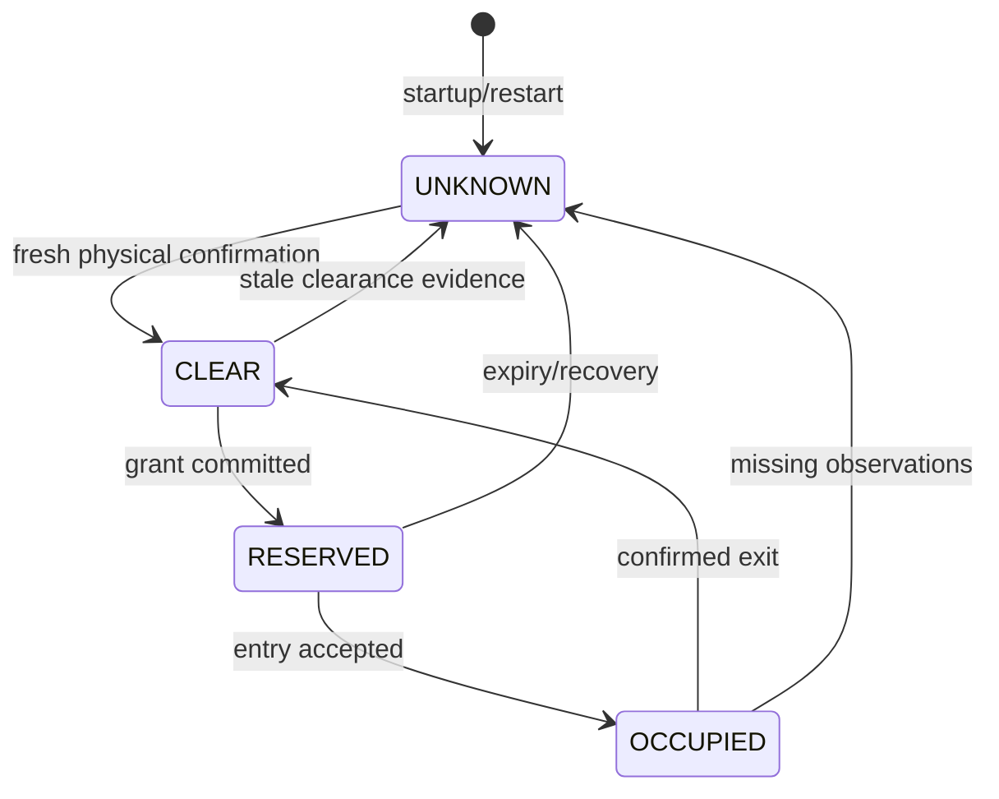

# Member 3 report draft

This text describes the implemented standalone component. Shorten it when integrating
the group's six-page article. Add actual integrated measurements once Member 4 supplies
them; do not describe these standalone outcomes as whole-system results.

## System Design: trusted access gate, fencing and occupancy

CraneLock separates digital coordination authority from physical lane clearance. A
single trusted gate mediates every simulated lane entry. It maintains the highest
accepted epoch, authorised crane identity and authority revision. Recovery proposals
require signatures from a strict majority of the fixed crane membership. The gate
checks each signature against the configured public key and requires all signatures
to cover one identical proposal. The signed proposal also binds the lane, membership
configuration and previous authority snapshot, preventing reuse in another lane or
after an intervening token handoff. Recovery certificates advance the epoch; ordinary
holder changes advance the revision without changing the epoch. Both values fence
old permissions.

Digital recovery does not establish physical emptiness. The gate models the lane as
CLEAR, RESERVED, OCCUPIED or UNKNOWN. A request from the authorised holder creates a
time-bound reservation only when fresh trusted evidence confirms that the lane is
clear. The simulator's entry boundary must validate that grant with the gate before
admitting the crane. Acceptance atomically moves the lane to OCCUPIED. A trusted exit
observation or simulated operator clearance is required to establish CLEAR again.

Grant expiry, missing position updates and restart produce uncertainty rather than
automatic clearance. Recovery revokes obsolete permissions while preserving occupied
or unknown physical state. Consequently, a reachable majority can recover digital
authority while still being unable to issue safe entry permission. This explicitly
trades availability for safety when physical clearance cannot be confirmed.

The model assumes one active gate, fixed membership, protocol-following authenticated
agents and accurate trusted simulator/operator observations. It excludes malicious
cranes, replicated-gate consensus and industrial safety certification. The recovery
component durably prevents a member from signing conflicting proposals for one target
epoch; the gate independently verifies the resulting certificate and current snapshot.

## Implementation: concurrency, durability and communication

The gate is implemented in Python, with a transport-independent decision core and a
gRPC service. Its protobuf envelope carries canonical JSON commands signed with
library-provided Ed25519. Each signature binds the operation, actor, lane, membership,
request identifier and operation-specific fields. Recovery signatures use a separate
domain, preventing a certificate signature from being reused as a command signature.
Mutual TLS is supported for network deployments so clients also authenticate gate
responses; plaintext listeners are limited to loopback or explicitly enabled isolated
development simulations.

An in-process lock serialises state-changing operations. SQLite transactions commit
authority, grant, occupancy, request-cache and audit changes together before returning
success. The database runs in write-ahead-log mode with full synchronous commits, so
read-only audit exports never block decisions. A process-level database lease prevents a second process from concurrently
using the same state file. Concurrent grant requests therefore cannot independently
observe CLEAR and both create accepted reservations. Durable grant and entry checks
also prevent multiple admissions through reordered requests.

Idempotency uses persisted request identifiers and payload fingerprints. Identical
authenticated retries return the original decision, but identify it as a replay with
no newly applied action. Reusing an identifier for a different command is rejected.
The simulator must never move on a replay acknowledgement or transport failure. This
conservative rule prevents ambiguous retries from creating another physical entry,
although a lost successful reply can require reconciliation and explicit clearance.

Occupancy reports bind to a physical lane session and phase revision, monotonically
increasing sequence numbers and freshness-bounded observation timestamps. The phase
revision changes at entry, preventing a pre-entry observation from clearing post-entry
occupancy even with clock skew. Each new grant creates a new
session; restart creates a new reconciliation session. Delayed observations from an
older session cannot clear a later occupancy. Sequence ordering is combined with
timestamp freshness, because a higher sequence number alone does not prove current
physical position. A watchdog checks for lost observations and unentered grant expiry.
Detected clock rollback invalidates digital permission and blocks commands.

The server opens existing state only. Startup validates the database/configuration
binding, retains authority, invalidates outstanding grants and requires fresh lane
confirmation. Missing or corrupt databases do not trigger automatic initialisation.
Persistence errors cause a denial and permanently disable new commands until valid
storage is restored and the gate restarted. The gRPC health service reports storage
failure, while UNKNOWN occupancy remains a healthy fail-closed operational condition.

Structured JSON events and Prometheus metrics expose decisions, fencing failures,
entry counts and UNKNOWN duration. Docker and Kubernetes templates provide persistent
storage, a single active replica and health checks. Local Docker execution and restart
persistence were validated; Kubernetes execution must be validated in the team's cluster.

## Evidence and remaining integration

[SAFETY_PROOF.md](SAFETY_PROOF.md) maps each safety claim (exclusive access, stale-permission
fencing, fallback, mid-transfer failures and occupied-lane recovery) to its tests,
including a randomised failure model check and a mutation check of the tests themselves.

The automated standalone suite tests certificate quorum/signature failures, normal
handoff fencing, concurrent grants and entries, expiry, missing/delayed observations,
restart, idempotent retries, clock rollback, commit failure, controller reconciliation,
real gRPC communication, health/metrics and mutual TLS. Three deterministic sequences
also exercise 250 actions each against an independent physical-occupancy model, retaining
the previous physical occupant across digital recovery and gate restart.

The demonstration admits a valid holder, rejects its stale authority after recovery
and blocks the replacement holder until the previous occupancy is explicitly cleared.
These are component-level checks. The recovery suite additionally verifies majority
and minority partitions, durable non-equivocation, and old-holder fencing. The full
proposal still requires yard-simulator, controller and platform-failure integration.
Safety-checker traces, baseline comparisons, latency, fairness,
throughput and scalability measurements remain the integrated evaluation's responsibility.
